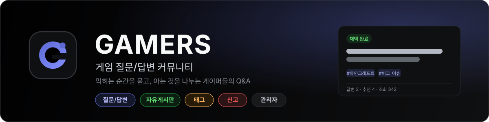
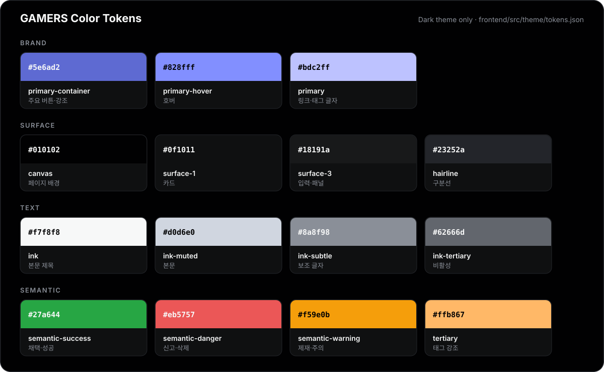

<p align="center">
  
</p>

<p align="center">
  
  
  
  
  
  
</p>

# GAMERS

세상에는 수많은 게임이 존재하지만, 모든 게임이 활발한 커뮤니티를 가지고 있는 것은 아닙니다.

대부분의 게임 커뮤니티는 인지도 높은 메이저 게임을 중심으로 형성되어 있고, 

상대적으로 인기가 적거나 출시된 지 오래된 게임은 공략 정보를 찾거나 다른 이용자와 소통할 공간조차 부족하거나 아예 존재하지 않는 경우가 많습니다.

소위 “한줌단” 이라고 불리는 소수의 이용자들 역시 자신이 좋아하는 게임을 즐기는 “게이머” 입니다. 

***GAMERS*** 는 누구나 원하는 게임의 커뮤니티를 만들고, 질문과 답변을 통해 공략 정보를 공유할 수 있는 게이머 중심의 Q&A 커뮤니티 서비스입니다.

### 게이머가 만들어가는 커뮤니티

***GAMERS*** 는 운영자가 아닌 **이용자의 자발적인 참여와 활동을 중심으로 성장하는 커뮤니티**를 지향합니다.

이용자들은 게임에 대한 질문을 등록하고, 자신이 알고 있는 공략과 경험을 답변으로 공유하며 함께 정보를 축적합니다.

또한 이용자들의 지속적인 참여를 유도하기 위해 **활동 기반 계정 레벨 시스템**을 도입합니다. 

질문과 답변 등의 커뮤니티 활동을 통해 경험치를 획득하고, 레벨에 따라 특별한 프로필 꾸미기 요소를 제공하여 활동에 대한 성취감과 보상을 경험할 수 있도록 합니다.

### 누군가에겐 ***“갓겜”*** 입니다.

누군가에게는 이름조차 생소한 게임이 다른 누군가에게는 오랫동안 기억에 남는 최고의 게임일 수 있습니다.

***GAMERS*** 는 메이저 게임뿐 아니라 이용자가 적은 비주류 게임, 출시된 지 오래되어 공략 정보를 찾기 어려운 게임까지 다양한 게임을 아우르고자 합니다.

이를 위해 **이용자가 직접 새로운 태그를 등록할 수 있는 시스템**을 제공하여, 

기존 커뮤니티에서 다루지 않는 게임도 자유롭게 질문하고 정보를 공유할 수 있도록 합니다.

**게임의 인기가 아닌, 게임을 즐기는 사람들의 관심과 참여로 만들어지는 공간.**

***GAMERS*** 는 모든 게이머의 게임 경험이 존중받고 공유될 수 있는 커뮤니티를 목표로 합니다.

> 멋쟁이사자처럼 백엔드 스쿨 11기 기본 프로젝트 1팀

## 목차

- [주요 기능](#주요-기능)
- [팀원과 담당 파트](#팀원과-담당-파트)
- [기술 스택](#기술-스택)
- [프로젝트 구조](#프로젝트-구조)
- [로컬에서 실행하기](#로컬에서-실행하기)
- [테스트 계정](#테스트-계정)
- [문서](#문서)
- [디자인 시스템](#디자인-시스템)
- [협업 방식](#협업-방식)

## 주요 기능

| 영역           | 기능                                                                                                                                                  |
| -------------- | ----------------------------------------------------------------------------------------------------------------------------------------------------- |
| **질문/답변**  | 질문 목록(검색·정렬·필터·페이지), 질문 작성·수정·삭제, 상세(조회수 24시간 규칙), 답변 작성·수정·삭제, 추천, 채택, 수정 이력, 관련 질문, 커뮤니티 통계 |
| **태그**       | 태그 목록·인기 태그, 태그 정규화(`LOL` = `lol`), 질문 등록 시 자동 생성, 차단·병합 태그 반영                                                          |
| **자유게시판** | 게시글 목록·작성·수정·삭제, 댓글, 조회수                                                                                                              |
| **신고**       | 질문·답변·게시글·댓글 신고, 증빙 이미지 첨부, 접수 후 10초 안 취소, 내 신고 내역                                                                      |
| **회원**       | 회원가입(아이디·닉네임·이메일 중복 확인), 로그인(JWT, 로그인 유지), 아이디·비밀번호 찾기, 마이페이지·공개 프로필, 비밀번호 변경, 회원 탈퇴            |
| **공지**       | 헤더 공지 롤링, 공지 목록·상세                                                                                                                        |
| **관리자**     | 대시보드, 회원 관리(제재·권한 부여), 게시물·답변·댓글 숨김/복구/삭제, 태그 관리(차단·병합), 공지 관리, 신고 처리, 활동 로그                           |
| **공통**       | 비회원 열람, 로그인 필요 안내, 모든 삭제는 soft delete, 본문 에디터 이미지 업로드와 미사용 파일 자동 정리                                             |

## 팀원과 담당 파트

| 팀원   | GitHub                                           | 담당                               | 키워드                                                                                                                                                       |
| ------ | ------------------------------------------------ | ---------------------------------- | ------------------------------------------------------------------------------------------------------------------------------------------------------------ |
| 김승연 | [@nullsector12](https://github.com/nullsector12) | 질문/답변 · 태그 · 신고 · 첨부파일 | `질문 CRUD` `답변 추천·채택` `수정 이력` `조회수` `커뮤니티 통계` `태그 정규화` `신고 등록·취소` `파일 업로드·정리 작업` `Q&A 화면 API 연동` `테스트 데이터` |
| 오은수 | [@oeuns2219](https://github.com/oeuns2219)       | 회원 · 인증 · 마이페이지           | `회원가입` `로그인·JWT` `Argon2id` `아이디·비밀번호 찾기` `마이페이지·프로필` `비밀번호 변경` `회원 탈퇴`                                                    |
| 김건희 | [@gunheekk](https://github.com/gunheekk)         | 관리자 · 공지                      | `관리자 권한` `대시보드` `회원 제재·권한 부여` `콘텐츠 숨김·복구·삭제` `태그 차단·병합` `신고 처리` `공지 관리` `활동 로그`                                  |
| 이시현 | [@efkoskf](https://github.com/efkoskf)           | 자유게시판                         | `게시글 CRUD` `댓글` `조회수` `게시판 화면`                                                                                                                  |

각 팀원은 맡은 영역의 백엔드 API와 프론트엔드 화면을 함께 개발합니다. 세부 작업은 [GitHub Issues](https://github.com/likelion-backendschool-11st/basic-project-1team/issues)와 [요구사항 명세](docs/02-requirements.md)의 담당자 열에서 볼 수 있습니다.

## 기술 스택

| 구분     | 사용 기술                                                                |
| -------- | ------------------------------------------------------------------------ |
| Backend  | Node.js 26, Express 5 (ESM), mysql2, JWT(HS256), Argon2id, multer        |
| Database | MySQL 8.4 (`utf8mb4_0900_as_cs`, 시각은 UTC)                             |
| Frontend | React 18.3, TypeScript, Vite, Tailwind CSS, React Router, Froala Editor  |
| 협업     | GitHub Issues·Pull Requests, CODEOWNERS 자동 리뷰 요청, ESLint, Prettier |

## 프로젝트 구조

```text
.
├── backend/                # Express API 서버
│   ├── src/
│   │   ├── modules/        # 도메인별 route · controller · service · repository · validator
│   │   ├── common/         # 미들웨어, 에러, 공통 유틸
│   │   ├── config/         # 환경 변수, DB 연결, 개발용 테스트 데이터
│   │   ├── app.js          # Express app (listen 하지 않음)
│   │   └── server.js       # 서버 시작·종료, 주기 작업
│   └── docs/               # API 명세, 백엔드 코딩 컨벤션
├── frontend/               # React SPA (Vite)
│   ├── src/apps/           # site(사용자 화면 진입점) · web(회원) · board · qna · admin
│   ├── src/shared/         # 공통 API·레이아웃·에디터
│   ├── src/theme/          # 디자인 토큰 (tokens.json)
│   └── docs/               # 프론트엔드 코딩 컨벤션, 디자인 자료
├── db/                     # DB·계정 생성, 스키마, 테스트 데이터 SQL
└── docs/                   # 요구사항, 명세 비교, DB 설계, Git 컨벤션
```

| URL                                   | 화면       |
| ------------------------------------- | ---------- |
| `/`, `/login`, `/signup`, `/mypage` … | 회원·계정  |
| `/qna/*`                              | 질문/답변  |
| `/board/*`                            | 자유게시판 |
| `/admin/*`                            | 관리자     |

## 로컬에서 실행하기

### 1. 준비

- Node.js 26 이상
- MySQL 8.4 (8.0.16 이상)

### 2. DB 만들기

```bash
# 관리자 계정으로 DB와 계정(gamers / gamers)을 만든다. 다시 실행해도 안전하다
mysql -u root -p < db/create-user.sql

# 만든 계정으로 테이블을 만든다 (빈 DB에 한 번)
mysql -u gamers -p gamers_db < db/schema.sql
```

### 3. 백엔드 실행 (http://localhost:3000)

```bash
cd backend
cp .env.example .env    # DB_PASSWORD=gamers, JWT_SECRET 을 채운다
npm install
npm run dev             # 파일을 고치면 자동 재시작
```

- `JWT_SECRET`은 `node -e "console.log(require('node:crypto').randomBytes(32).toString('hex'))"`로 만들 수 있습니다.
- `NODE_ENV=development`로 처음 실행하면 **테스트 데이터(`db/seed.sql`)가 자동으로 한 번** 들어갑니다. 로그에 `[dev-seed] 테스트 데이터를 넣었습니다`가 보이면 완료입니다. 넣지 않으려면 `.env`에 `DB_SEED=false`를 둡니다.
- 업로드한 파일은 `backend/uploads/`에 저장되고, 글에 연결되지 않은 파일은 서버가 1시간마다 정리합니다.

### 4. 프론트엔드 실행 (http://localhost:5173)

```bash
cd frontend
npm install
npm run dev             # /api 요청은 http://localhost:3000 으로 프록시
```

### 5. 검사

| 위치        | 명령                                                                         |
| ----------- | ---------------------------------------------------------------------------- |
| `backend/`  | `npm run lint`, `npm run format:check`                                       |
| `frontend/` | `npm run typecheck`, `npm run lint`, `npm run format:check`, `npm run build` |

## 테스트 계정

`db/seed.sql`로 들어가는 계정입니다. 비밀번호는 모두 **`gamers12!`** 입니다.

| 아이디                                                                                                       | 닉네임     | 용도                                        |
| ------------------------------------------------------------------------------------------------------------ | ---------- | ------------------------------------------- |
| `seed_admin`                                                                                                 | 운영자     | 관리자 화면 (`/admin`)                      |
| `seed_mod`                                                                                                   | 모더레이터 | 게시물 관리 권한(`content_manage`) 회원     |
| `seed_hoya`, `seed_raid`, `seed_build`, `seed_newbie`, `seed_tank`, `seed_heal`, `seed_speed`, `seed_modder` | 호야 외    | 일반 회원                                   |
| `seed_writeban`                                                                                              | 글쓰기제한 | 글쓰기 제한 중 (작성 시 `403 WRITE_BANNED`) |
| `seed_commentban`                                                                                            | 댓글제한   | 댓글 제한 중                                |
| `seed_suspended`                                                                                             | 이용정지   | 이용 정지 중 (로그인 불가)                  |

질문 33개(숨김·삭제 포함), 답변·추천·채택, 태그(차단·병합 포함), 게시글·댓글, 공지, 신고(대기·처리·반려·취소), 제재, 관리자 활동 로그가 함께 들어갑니다. 다시 넣으려면 DB를 비우고 `schema.sql`부터 다시 실행합니다.

## 문서

| 문서                                                       | 내용                                                            |
| ---------------------------------------------------------- | --------------------------------------------------------------- |
| [요구사항 명세](docs/02-requirements.md)                   | 영역별 요구사항(REQ-*)과 담당자                                 |
| [요구사항 · API 명세 비교](docs/03-spec-gap-review.md)     | 두 문서의 차이와 DB 설계 전 정한 규칙                           |
| [DB 설계](docs/04-db-design.md)                            | 테이블·인덱스·제약 설계와 근거                                  |
| [API 명세](backend/docs/API_SPEC.md)                       | 전체 REST API, 공통 규칙(인증·제재·페이지·삭제 정책), 에러 코드 |
| [DB 스키마](db/schema.sql) · [테스트 데이터](db/seed.sql)  | 실제 DDL과 로컬 개발용 데이터                                   |
| [백엔드 코딩 컨벤션](backend/docs/CODE_CONVENTION.md)      | 레이어 책임, 이름 규칙, 에러 처리, 디렉터리 구조                |
| [프론트엔드 코딩 컨벤션](frontend/docs/CODE_CONVENTION.md) | 모듈 구조, API 호출, 컴포넌트·hook 규칙                         |
| [프론트엔드 안내](frontend/README.md)                      | 모듈 통합 구조, 라우팅, 에디터 라이선스                         |
| [Git 컨벤션](docs/GIT_CONVENTION.md)                       | 브랜치, 커밋 메시지, PR·리뷰 규칙                               |
| [디자인 자료](frontend/docs/design)                        | 모듈별 화면 디자인 원본                                         |

## 디자인 시스템

화면은 **다크 테마 하나**만 사용합니다. 모든 모듈이 [`frontend/src/theme/tokens.json`](frontend/src/theme/tokens.json) 디자인 토큰을 Tailwind preset으로 함께 쓰므로, 색·간격·글꼴은 이 파일에서 바꿉니다.

<p align="center">
  
</p>

| 구분    | 토큰                                                                                    |
| ------- | --------------------------------------------------------------------------------------- |
| 글꼴    | 본문 `Inter`, 코드 `JetBrains Mono`                                                     |
| 브랜드  | `primary-container` #5e6ad2 → `primary-hover` #828fff 그라디언트 (로고·주요 버튼)       |
| 상태 색 | 채택·성공 `semantic-success`, 신고·삭제 `semantic-danger`, 제재·주의 `semantic-warning` |

## 협업 방식

- `main`(배포) ← `develop`(통합) ← `feature/*`, `fix/*` 브랜치로 작업하고 PR로만 병합합니다.
- 커밋 메시지는 `타입: 내용` (`feat`, `fix`, `refactor`, `style`, `docs` …) 형식으로 한국어로 씁니다.
- PR을 열면 CODEOWNERS로 작성자를 뺀 팀원 전원에게 리뷰가 요청되고, 1명 이상 승인하면 병합합니다.
- 구현 전에 API 명세를 먼저 확인하고, 명세에 없던 규칙을 정하면 명세에도 반영합니다.

자세한 규칙은 [Git 컨벤션](docs/GIT_CONVENTION.md)과 각 코딩 컨벤션 문서를 따릅니다.
