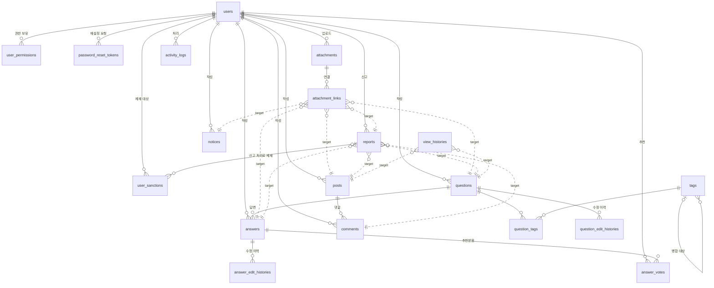
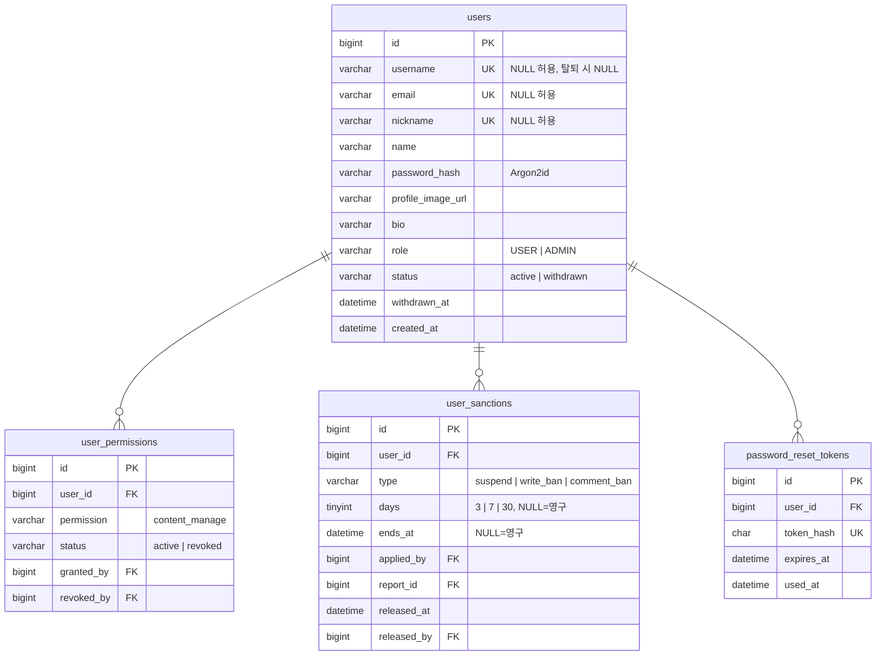
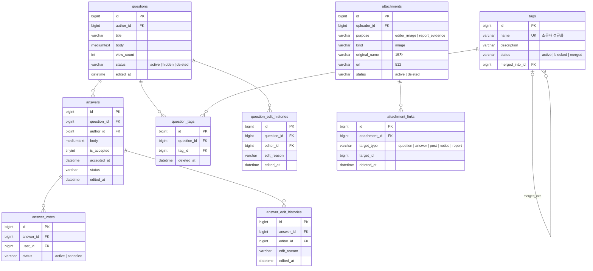
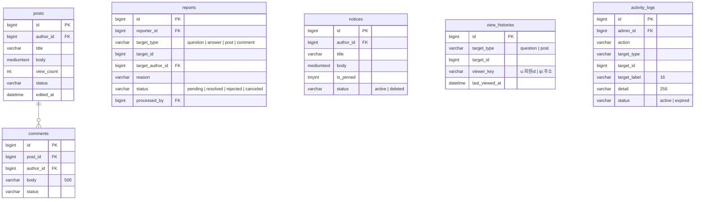

# DB 테이블 설계안 (MySQL 8)

- 작성일: 2026-11-12
- 근거: [`backend/docs/API_SPEC.md`](../backend/docs/API_SPEC.md), [`docs/02-requirements.md`](02-requirements.md), [`docs/03-spec-gap-review.md`](03-spec-gap-review.md)
- 기준 명세: `feature/spec-gap-review` 브랜치의 API 명세(`dbc67af`)를 병합한 이 브랜치의 명세
- 범위: 테이블·컬럼·관계·인덱스 설계. SQL(DDL)은 이 설계를 확정한 뒤 작성합니다.
- 제외: 명세 [11.1 범위 제외 / 후순위](../backend/docs/API_SPEC.md#111-범위-제외--후순위-항목) 항목(레벨, 질문 추천, 카테고리, 알림, 태그 상세·동의어)

## 목차

1. [공통 규칙](#1-공통-규칙)
2. [테이블 관계도](#2-테이블-관계도)
3. [테이블 목록](#3-테이블-목록)
4. [테이블 상세](#4-테이블-상세)
5. [계산 값 (저장하지 않는 값)](#5-계산-값-저장하지-않는-값)
6. [명세에 없어서 설계에서 정한 것](#6-명세에-없어서-설계에서-정한-것)

---

## 1. 공통 규칙

| 항목 | 규칙 | 이유 |
| --- | --- | --- |
| 문자셋 / 정렬 규칙 | DB·모든 테이블 `utf8mb4` / `utf8mb4_0900_as_cs` | 명세 1.10 대소문자 구분. MySQL 8 기본값 `utf8mb4_0900_ai_ci`는 대소문자를 구분하지 않으므로 **반드시 명시**합니다. `utf8mb4_bin`보다 한글 정렬 순서가 자연스럽고, 끝 공백을 다른 값으로 봅니다(NO PAD) |
| 테이블·컬럼 이름 | 소문자 `snake_case`, 테이블은 복수형 | API는 `camelCase`, DB는 `snake_case`로 나누고 Repository에서 변환합니다 |
| PK | `id BIGINT UNSIGNED AUTO_INCREMENT` | 명세 1.4 "숫자 PK는 항상 `id`". 신고·조회 기록처럼 많이 쌓이는 테이블도 같은 타입으로 맞춥니다 |
| 날짜·시간 | `DATETIME(3)`, **UTC**로 저장 | 명세는 밀리초까지 ISO 8601(UTC). `TIMESTAMP`는 2038년 한계가 있어 쓰지 않습니다 |
| `created_at` / `updated_at` | 모든 테이블에 둠. `updated_at`은 `ON UPDATE CURRENT_TIMESTAMP(3)` | 행이 언제 바뀌었는지 추적. 화면의 "수정일"은 `updated_at`이 아니라 `edited_at`을 씁니다 |
| 상태·종류 값 | `VARCHAR(20~32)` + `CHECK` 제약 | 명세 Enum 값(소문자 `snake_case`, 활동 로그 action은 대문자)을 그대로 저장. `ENUM` 타입은 값을 추가할 때마다 테이블 변경이 필요해 피합니다 |
| Boolean | `TINYINT(1)`, 이름은 `is_` / `has_` | 명세 1.4와 같은 규칙 |
| 삭제 | **행 삭제 없음.** `status` + `deleted_at` | 명세 1.7 soft delete. 연결 테이블도 `deleted_at`으로 끊습니다 |
| FK | 모두 `ON DELETE RESTRICT` / `ON UPDATE RESTRICT` | 행을 지우지 않으므로 CASCADE가 필요 없고, 실수로 지우는 것을 DB가 막습니다. 하위 데이터 삭제 상태 변경은 앱이 한 트랜잭션에서 처리합니다 |
| 다형 참조 | `target_type` + `target_id` (FK 없음) | 신고·첨부 연결·조회 기록·활동 로그는 대상이 여러 테이블이라 FK를 걸 수 없습니다. 대상 존재 여부는 앱에서 확인합니다 |
| 저장 엔진 | InnoDB | 트랜잭션, FK, 행 잠금(채택 시 질문 행 잠금, 명세 1.10) |

### 1.1 콘텐츠 상태 컬럼 (질문·답변·게시글·댓글 공통)

| 컬럼 | 타입 | 설명 |
| --- | --- | --- |
| `status` | `VARCHAR(20)` NOT NULL DEFAULT `'active'` | `active` / `hidden` / `deleted` |
| `hidden_at` | `DATETIME(3)` NULL | 숨김 시각 |
| `deleted_at` | `DATETIME(3)` NULL | 삭제 시각 |

- 숨김은 관리자(또는 `content_manage` 회원)가 직접 할 때만 생깁니다. 신고가 쌓여도 자동으로 숨기지 않으므로(명세 8장, REQ-QNA-008·009) 숨김 출처를 따로 저장하지 않습니다. 신고를 반려해도 콘텐츠 상태는 바뀌지 않습니다.

---

## 2. 테이블 관계도

GitHub에서 이 문서를 열면 아래 코드가 그림으로 표시됩니다. 실선은 FK, 점선은 FK 없이 `target_type`·`target_id`로 가리키는 다형 참조입니다.

### 2.1 전체 관계

### 2.2 회원 · 권한 · 제재

### 2.3 질문 · 답변 · 태그 · 첨부

### 2.4 자유게시판 · 신고 · 공지 · 기록

---

## 3. 테이블 목록

| # | 테이블 | 설명 | 관련 명세 |
| --- | --- | --- | --- |
| 1 | `users` | 회원 (탈퇴하면 비식별 처리한 행으로 남음) | 2장, 1.8, 1.10 |
| 2 | `user_permissions` | 관리자가 준 추가 권한 (`content_manage`, 후순위) | 1.2, 10.2 |
| 3 | `user_sanctions` | 회원 제재 1건 = 1행. 제재·해제 이력을 겸함 | 1.2, 10.2, 10.6 |
| 4 | `password_reset_tokens` | 비밀번호 찾기 재설정 토큰 (10분, 1회) | 2장 |
| 5 | `questions` | 질문 | 3장 |
| 6 | `question_edit_histories` | 질문 수정 이력 | 3장 |
| 7 | `answers` | 답변 (채택 여부 포함) | 4장 |
| 8 | `answer_edit_histories` | 답변 수정 이력 | 4장 |
| 9 | `answer_votes` | 답변 추천 (취소하면 `canceled`, 다시 추천하면 같은 행 재사용) | 4장 |
| 10 | `tags` | 태그 (`active` / `blocked` / `merged`) | 5장, 10.5 |
| 11 | `question_tags` | 질문-태그 연결 | 3장, 5장 |
| 12 | `attachments` | 업로드한 파일 정보 (URL 저장) | 1.6, 6장 |
| 13 | `attachment_links` | 에디터 이미지-글(질문·답변·게시글·공지), 신고 증빙-신고 연결 | 6장 |
| 14 | `posts` | 자유게시판 게시글 | 7장 |
| 15 | `comments` | 자유게시판 댓글 | 7장 |
| 16 | `reports` | 신고 | 8장, 10.6 |
| 17 | `notices` | 공지 | 9장, 10.7 |
| 18 | `view_histories` | 조회수 중복 방지 기록 (대상·조회자별 1행) | 1.10 |
| 19 | `activity_logs` | 관리자 활동 로그 (5년 보관) | 10.8 |

---

## 4. 테이블 상세

표의 "NULL" 칸: `N` = NOT NULL, `Y` = NULL 허용.

### 4.1 `users`

| 컬럼 | 타입 | NULL | 기본값 | 설명 |
| --- | --- | --- | --- | --- |
| `id` | `BIGINT UNSIGNED` | N | AUTO_INCREMENT | PK |
| `username` | `VARCHAR(20)` | Y | | 로그인 아이디. 4~20자, 영문 소문자·숫자·`_`. 탈퇴 시 `NULL` |
| `email` | `VARCHAR(128)` | Y | | 탈퇴 시 `NULL` |
| `nickname` | `VARCHAR(16)` | Y | | 2~16자, 영문·한글만. 탈퇴 시 `NULL` |
| `name` | `VARCHAR(16)` | Y | | 실명. 1~16자. 탈퇴 시 `NULL` |
| `password_hash` | `VARCHAR(255)` | Y | | Argon2id 해시 (파라미터 포함). 탈퇴 시 `NULL` |
| `profile_image_url` | `VARCHAR(512)` | Y | | 저장소 URL. 탈퇴 시 `NULL` (파일은 저장소에서 삭제) |
| `bio` | `VARCHAR(1000)` | Y | | 소개글 HTML (순수 글자 200자, 저장 HTML 1,000자). 탈퇴 시 `NULL` |
| `role` | `VARCHAR(10)` | N | `'USER'` | `USER` / `ADMIN` |
| `status` | `VARCHAR(20)` | N | `'active'` | `active` / `withdrawn` |
| `withdrawn_at` | `DATETIME(3)` | Y | | 탈퇴 시각 |
| `created_at` | `DATETIME(3)` | N | 현재 시각 | 가입일 |
| `updated_at` | `DATETIME(3)` | N | 현재 시각 | |

- 가입 정보 컬럼이 NULL 허용인 이유: 탈퇴하면 비워야 하기 때문입니다(명세 1.10). 가입할 때는 앱이 모두 필수로 검사합니다.
- 관리자 API의 `restricted` / `suspended`는 저장하지 않고 `user_sanctions`로 계산합니다. ([5장](#5-계산-값-저장하지-않는-값))

| 인덱스 | 컬럼 | 이유 |
| --- | --- | --- |
| PK | `id` | |
| UNIQUE `uk_users_username` | `username` | 아이디 중복 불가, 로그인(`loginId`가 아이디일 때) 조회. `NULL`은 unique에 걸리지 않아 탈퇴 회원 값 재사용이 됩니다 |
| UNIQUE `uk_users_email` | `email` | 이메일 중복 불가, 로그인(`loginId`가 이메일일 때)·아이디 찾기(이름+이메일)·비밀번호 찾기 조회 |
| UNIQUE `uk_users_nickname` | `nickname` | 닉네임 중복 불가, 중복 확인 API |
| `idx_users_status_created` | `status, created_at` | 관리자 회원 목록(탈퇴 제외·가입일 정렬), 대시보드 오늘 가입 수·추이 |
| `idx_users_role_status` | `role, status` | 활동 로그 관리자 선택 목록(`role=ADMIN`), 관리자 회원 목록 `role` 필터 |

### 4.2 `user_permissions`

| 컬럼 | 타입 | NULL | 기본값 | 설명 |
| --- | --- | --- | --- | --- |
| `id` | `BIGINT UNSIGNED` | N | AUTO_INCREMENT | PK |
| `user_id` | `BIGINT UNSIGNED` | N | | FK → `users.id` |
| `permission` | `VARCHAR(32)` | N | | 지금은 `content_manage`만 |
| `status` | `VARCHAR(20)` | N | `'active'` | `active` / `revoked` |
| `granted_by` | `BIGINT UNSIGNED` | N | | FK → `users.id` (관리자) |
| `granted_at` | `DATETIME(3)` | N | | |
| `revoked_by` | `BIGINT UNSIGNED` | Y | | FK → `users.id` |
| `revoked_at` | `DATETIME(3)` | Y | | |
| `created_at`, `updated_at` | `DATETIME(3)` | N | | |

- 회수하면 행을 지우지 않고 `revoked`로 바꿉니다. 다시 주면 같은 행을 `active`로 되돌리고 `granted_*`를 갱신합니다. (답변 추천과 같은 방식) 누가 언제 주고 회수했는지의 전체 이력은 활동 로그(`GRANT_PERMISSION` / `REVOKE_PERMISSION`)에 남습니다.

| 인덱스 | 컬럼 | 이유 |
| --- | --- | --- |
| UNIQUE `uk_user_permissions` | `user_id, permission` | 회원당 권한 종류별 1행. 인증 미들웨어가 매 요청 권한을 확인할 때 이 인덱스로 조회합니다 |

### 4.3 `user_sanctions`

| 컬럼 | 타입 | NULL | 기본값 | 설명 |
| --- | --- | --- | --- | --- |
| `id` | `BIGINT UNSIGNED` | N | AUTO_INCREMENT | PK |
| `user_id` | `BIGINT UNSIGNED` | N | | FK → `users.id` (제재 대상) |
| `type` | `VARCHAR(20)` | N | | `suspend` / `write_ban` / `comment_ban` |
| `days` | `TINYINT UNSIGNED` | Y | | `3` / `7` / `30`, `NULL`이면 영구 |
| `reason` | `VARCHAR(200)` | N | | 제재 사유. 신고 처리면 `신고 처리: <사유> (신고 #id)` |
| `starts_at` | `DATETIME(3)` | N | | 제재 시작 |
| `ends_at` | `DATETIME(3)` | Y | | 해제 예정 시각 (`starts_at + days`). `NULL`이면 영구 |
| `applied_by` | `BIGINT UNSIGNED` | N | | FK → `users.id` (관리자) |
| `report_id` | `BIGINT UNSIGNED` | Y | | FK → `reports.id`. 신고 처리로 건 제재일 때 |
| `released_at` | `DATETIME(3)` | Y | | 관리자가 해제한 시각. 기간 만료는 기록하지 않음 |
| `released_by` | `BIGINT UNSIGNED` | Y | | FK → `users.id` |
| `release_reason` | `VARCHAR(200)` | Y | | 해제 사유 |
| `created_at`, `updated_at` | `DATETIME(3)` | N | | |

- **걸려 있는 제재** = `released_at IS NULL AND (ends_at IS NULL OR ends_at > 현재)`. 기간이 지나면 별도 처리 없이 풀린다는 명세 1.2를 그대로 따릅니다.
- 회원 상세의 `sanctionHistory`는 이 테이블에서 만듭니다. 행마다 `apply`(시각 `starts_at`) 1건, 해제했으면 `release`(시각 `released_at`) 1건을 만들어 최신순으로 합칩니다.
- "같은 종류 제재가 이미 걸려 있으면 거절"은 앱에서 검사합니다. 만료 시각이 지나면 자동으로 풀리는 조건이라 DB unique 제약으로 막을 수 없습니다.

| 인덱스 | 컬럼 | 이유 |
| --- | --- | --- |
| `idx_user_sanctions_active` | `user_id, type, released_at, ends_at` | 매 요청 인증 미들웨어의 제재 확인, 같은 종류 중복 제재 검사. 회원 1명의 행만 읽습니다 |
| `idx_user_sanctions_user_created` | `user_id, created_at` | 회원 상세 제재 이력 최신순 |
| `idx_user_sanctions_status_filter` | `type, released_at, ends_at` | 관리자 회원 목록 `status=suspended/restricted` 필터 (걸려 있는 제재가 있는 회원 찾기) |
| FK 인덱스 | `applied_by`, `released_by`, `report_id` | FK에 필요 (MySQL이 자동 생성) |

### 4.4 `password_reset_tokens`

| 컬럼 | 타입 | NULL | 기본값 | 설명 |
| --- | --- | --- | --- | --- |
| `id` | `BIGINT UNSIGNED` | N | AUTO_INCREMENT | PK |
| `user_id` | `BIGINT UNSIGNED` | N | | FK → `users.id` |
| `token_hash` | `CHAR(64)` | N | | `resetToken`의 SHA-256 (원문은 저장하지 않음) |
| `expires_at` | `DATETIME(3)` | N | | 발급 + 10분 |
| `used_at` | `DATETIME(3)` | Y | | 사용 시각. 값이 있으면 다시 못 씀 |
| `created_at`, `updated_at` | `DATETIME(3)` | N | | |

| 인덱스 | 컬럼 | 이유 |
| --- | --- | --- |
| UNIQUE `uk_password_reset_tokens_hash` | `token_hash` | 재설정 요청 시 토큰으로 바로 조회 |
| FK 인덱스 | `user_id` | |

- 토큰 원문 대신 해시를 두는 이유: DB가 유출돼도 10분 안의 토큰으로 남의 비밀번호를 바꿀 수 없게 하기 위해서입니다.

### 4.5 `questions`

| 컬럼 | 타입 | NULL | 기본값 | 설명 |
| --- | --- | --- | --- | --- |
| `id` | `BIGINT UNSIGNED` | N | AUTO_INCREMENT | PK |
| `author_id` | `BIGINT UNSIGNED` | N | | FK → `users.id` |
| `title` | `VARCHAR(100)` | N | | 1~100자 |
| `body` | `MEDIUMTEXT` | N | | 저장 최대 100,000자 (명세 1.9) |
| `view_count` | `INT UNSIGNED` | N | `0` | 조회수 |
| `status`, `hidden_at`, `deleted_at` | | | | [1.1 콘텐츠 상태 컬럼](#11-콘텐츠-상태-컬럼-질문답변게시글댓글-공통) |
| `edited_at` | `DATETIME(3)` | Y | | 제목·본문·태그를 마지막으로 수정한 시각. `NULL`이면 수정 안 함(`isEdited: false`) |
| `created_at`, `updated_at` | `DATETIME(3)` | N | | |

- `isAccepted`, `answerCount`는 저장하지 않고 `answers`로 계산합니다. 채택을 답변 쪽 상태값으로 두기로 했기 때문입니다(명세 1.10).

| 인덱스 | 컬럼 | 이유 |
| --- | --- | --- |
| `idx_questions_status_created` | `status, created_at` | 질문 목록 기본 정렬 `latest`(숨김·삭제 제외), 관리자 목록, 대시보드 질문 추이 |
| `idx_questions_status_views` | `status, view_count` | 질문 목록 `sort=views` |
| `idx_questions_author_status_created` | `author_id, status, created_at` | 프로필 작성 목록·전체 보기(`authorId`), 프로필 `questionCount`, 관심 태그 계산 |

- 제목 `keyword` 검색은 부분 일치(`LIKE '%검색어%'`)라 B-tree 인덱스를 쓰지 못합니다. 데이터가 적은 지금은 `status` 인덱스로 범위를 줄인 뒤 검사하고, 느려지면 `ngram` FULLTEXT 인덱스를 추가합니다. (FULLTEXT는 단어 단위 검색이라 결과가 부분 일치와 조금 다를 수 있어 지금 넣지 않습니다.)

### 4.6 `question_edit_histories`

| 컬럼 | 타입 | NULL | 기본값 | 설명 |
| --- | --- | --- | --- | --- |
| `id` | `BIGINT UNSIGNED` | N | AUTO_INCREMENT | PK |
| `question_id` | `BIGINT UNSIGNED` | N | | FK → `questions.id` |
| `editor_id` | `BIGINT UNSIGNED` | N | | FK → `users.id` (작성자 또는 `content_manage` 회원) |
| `edit_reason` | `VARCHAR(200)` | Y | | 입력 안 하면 `NULL` |
| `edited_at` | `DATETIME(3)` | N | | 수정 시각. `questions.edited_at`과 같은 값 |
| `created_at`, `updated_at` | `DATETIME(3)` | N | | |

- 수정 전 본문은 저장하지 않습니다(명세 3장).

| 인덱스 | 컬럼 | 이유 |
| --- | --- | --- |
| `idx_question_edit_histories_question` | `question_id, edited_at` | 수정 이력 모달 (질문별 최신순 전체) |
| FK 인덱스 | `editor_id` | |

### 4.7 `answers`

| 컬럼 | 타입 | NULL | 기본값 | 설명 |
| --- | --- | --- | --- | --- |
| `id` | `BIGINT UNSIGNED` | N | AUTO_INCREMENT | PK |
| `question_id` | `BIGINT UNSIGNED` | N | | FK → `questions.id` |
| `author_id` | `BIGINT UNSIGNED` | N | | FK → `users.id` |
| `body` | `MEDIUMTEXT` | N | | 저장 최대 100,000자 |
| `is_accepted` | `TINYINT(1)` | N | `0` | 채택 여부 |
| `accepted_at` | `DATETIME(3)` | Y | | 채택 시각 (오늘 채택 수 통계) |
| `status`, `hidden_at`, `deleted_at` | | | | [1.1](#11-콘텐츠-상태-컬럼-질문답변게시글댓글-공통) |
| `edited_at` | `DATETIME(3)` | Y | | 본문 마지막 수정 시각 |
| `created_at`, `updated_at` | `DATETIME(3)` | N | | |

- 질문당 채택 1개는 앱에서 검사합니다. 채택할 때 `SELECT ... FROM questions WHERE id = ? FOR UPDATE`로 질문 행을 잠그고, 같은 질문에 `is_accepted = 1`인 답변이 있는지 확인합니다(명세 1.10).
- 관리자가 채택된 답변을 삭제하면 `is_accepted`를 `0`으로 바꿔 질문의 채택 상태를 풉니다(명세 10.3). `accepted_at`은 기록으로 남깁니다.

| 인덱스 | 컬럼 | 이유 |
| --- | --- | --- |
| `idx_answers_question_status_accepted` | `question_id, status, is_accepted` | 질문 상세 답변 목록, 질문 목록의 `answerCount`·`hasAnswer`·`isAccepted` 계산과 필터, 채택 시 중복 검사 |
| `idx_answers_author_status_created` | `author_id, status, created_at, question_id` | 프로필 답변 목록(`GET /api/answers?authorId=`), `answerCount`, 답변한 질문 목록(`GET /api/questions?answerAuthorId=`). `question_id`를 끝에 둬서 답변한 질문 id를 테이블을 읽지 않고 인덱스만으로 찾습니다 |
| `idx_answers_status_created` | `status, created_at` | 관리자 답변 목록, 첫 답변까지 걸린 시간 통계 |
| `idx_answers_accepted_at` | `accepted_at` | 대시보드·질문 통계의 오늘 채택 수 |

### 4.8 `answer_edit_histories`

`question_edit_histories`와 같은 구조이고 `question_id` 대신 `answer_id`(FK → `answers.id`)를 둡니다.

| 인덱스 | 컬럼 | 이유 |
| --- | --- | --- |
| `idx_answer_edit_histories_answer` | `answer_id, edited_at` | 답변 수정 이력 모달 |
| FK 인덱스 | `editor_id` | |

- 질문·답변 이력을 한 테이블로 합치지 않는 이유: 명세가 두 테이블 이름을 따로 정했고, 따로 두면 대상에 FK를 걸 수 있습니다.

### 4.9 `answer_votes`

| 컬럼 | 타입 | NULL | 기본값 | 설명 |
| --- | --- | --- | --- | --- |
| `id` | `BIGINT UNSIGNED` | N | AUTO_INCREMENT | PK |
| `answer_id` | `BIGINT UNSIGNED` | N | | FK → `answers.id` |
| `user_id` | `BIGINT UNSIGNED` | N | | FK → `users.id` (추천한 회원) |
| `status` | `VARCHAR(20)` | N | `'active'` | `active` / `canceled` |
| `created_at`, `updated_at` | `DATETIME(3)` | N | | |

| 인덱스 | 컬럼 | 이유 |
| --- | --- | --- |
| UNIQUE `uk_answer_votes` | `answer_id, user_id` | 회원당 답변 1행. 취소 후 다시 추천하면 같은 행을 `active`로 바꿉니다(명세 4장). `isVoted` 조회 |
| `idx_answer_votes_answer_status` | `answer_id, status` | `voteCount` 계산, 추천순 정렬 |
| `idx_answer_votes_user` | `user_id` | FK 인덱스 |

### 4.10 `tags`

| 컬럼 | 타입 | NULL | 기본값 | 설명 |
| --- | --- | --- | --- | --- |
| `id` | `BIGINT UNSIGNED` | N | AUTO_INCREMENT | PK |
| `name` | `VARCHAR(30)` | N | | 정규화한 이름 (`#` 제거, 영문 소문자) |
| `description` | `VARCHAR(100)` | Y | | |
| `status` | `VARCHAR(20)` | N | `'active'` | `active` / `blocked` / `merged` |
| `merged_into_id` | `BIGINT UNSIGNED` | Y | | FK → `tags.id`. `merged`일 때 병합 대상 |
| `blocked_at` | `DATETIME(3)` | Y | | 관리자 삭제(차단) 시각 |
| `merged_at` | `DATETIME(3)` | Y | | 병합 시각 |
| `created_by` | `BIGINT UNSIGNED` | Y | | FK → `users.id`. 질문 작성 중 자동 생성이면 그 회원, 관리자 생성이면 관리자 |
| `created_at`, `updated_at` | `DATETIME(3)` | N | | |

| 인덱스 | 컬럼 | 이유 |
| --- | --- | --- |
| UNIQUE `uk_tags_name` | `name` | 상태와 관계없이 이름 1개. 차단된 이름은 다시 만들 수 없고(`TAG_BLOCKED`), 병합된 이름은 대상 태그로 바꿔 저장(명세 5.1). 자동완성 `LIKE '검색어%'`(앞부분 일치)도 이 인덱스를 씁니다 |
| `idx_tags_status` | `status, name` | 회원 화면 목록·자동완성에서 `blocked`·`merged` 제외, 관리자 `status` 필터 |
| FK 인덱스 | `merged_into_id`, `created_by` | |

### 4.11 `question_tags`

| 컬럼 | 타입 | NULL | 기본값 | 설명 |
| --- | --- | --- | --- | --- |
| `id` | `BIGINT UNSIGNED` | N | AUTO_INCREMENT | PK |
| `question_id` | `BIGINT UNSIGNED` | N | | FK → `questions.id` |
| `tag_id` | `BIGINT UNSIGNED` | N | | FK → `tags.id` |
| `deleted_at` | `DATETIME(3)` | Y | | 연결 해제 시각 (질문 수정, 태그 차단·병합) |
| `created_at`, `updated_at` | `DATETIME(3)` | N | | |

- 질문 수정에서 뺐던 태그를 다시 넣으면 같은 행의 `deleted_at`을 `NULL`로 되돌립니다.
- 병합: 원본 태그 연결은 `deleted_at`으로 끊고, 대상 태그가 연결돼 있지 않은 질문에 대상 태그를 연결합니다. 이때도 예전에 끊긴 대상 태그 행이 있으면 새로 만들지 않고 그 행을 되돌립니다.
- 연결은 항상 `INSERT ... ON DUPLICATE KEY UPDATE deleted_at = NULL`로 넣습니다. `uk_question_tags`는 끊긴 행까지 포함해 중복을 막으므로, 행이 있는지 보지 않고 새로 넣으면 unique 제약에 걸립니다.

| 인덱스 | 컬럼 | 이유 |
| --- | --- | --- |
| UNIQUE `uk_question_tags` | `question_id, tag_id` | 같은 질문에 같은 태그 1행 (끊긴 행 포함). 질문 상세·목록의 태그 조회 |
| `idx_question_tags_tag` | `tag_id, deleted_at, question_id` | 태그 필터(`tag=`), 태그별 질문 수(`questionCount`, 인기 태그), 관련 질문(태그가 겹치는 질문) |

### 4.12 `attachments`

| 컬럼 | 타입 | NULL | 기본값 | 설명 |
| --- | --- | --- | --- | --- |
| `id` | `BIGINT UNSIGNED` | N | AUTO_INCREMENT | PK |
| `uploader_id` | `BIGINT UNSIGNED` | N | | FK → `users.id` |
| `purpose` | `VARCHAR(20)` | N | | `editor_image`(본문 이미지) / `report_evidence`(신고 증빙) |
| `kind` | `VARCHAR(10)` | N | | `image` (이미지 파일만 받음. 다른 종류가 생길 때를 위해 컬럼은 둠) |
| `original_name` | `VARCHAR(15)` | N | | 원본 파일명. 15자 넘으면 확장자 유지하고 줄여 저장 |
| `url` | `VARCHAR(512)` | N | | 저장소 URL |
| `mime_type` | `VARCHAR(100)` | N | | 형식 검사·응답용 |
| `size` | `INT UNSIGNED` | N | | 바이트 (최대 10MB) |
| `status` | `VARCHAR(20)` | N | `'active'` | `active` / `deleted` |
| `deleted_at` | `DATETIME(3)` | Y | | 삭제 시각. 이때 저장소 파일도 지움 |
| `created_at`, `updated_at` | `DATETIME(3)` | N | | |

| 인덱스 | 컬럼 | 이유 |
| --- | --- | --- |
| `idx_attachments_status_created` | `status, created_at` | 24시간 동안 연결되지 않은 파일 정리 작업 |
| FK 인덱스 | `uploader_id` | 업로드한 회원만 첨부·삭제할 수 있는지 확인 |

### 4.13 `attachment_links`

| 컬럼 | 타입 | NULL | 기본값 | 설명 |
| --- | --- | --- | --- | --- |
| `id` | `BIGINT UNSIGNED` | N | AUTO_INCREMENT | PK |
| `attachment_id` | `BIGINT UNSIGNED` | N | | FK → `attachments.id` |
| `target_type` | `VARCHAR(20)` | N | | `question` / `answer` / `post` / `notice` / `report` |
| `target_id` | `BIGINT UNSIGNED` | N | | 대상 id (FK 없음) |
| `sort_order` | `TINYINT UNSIGNED` | N | `0` | 신고 증빙 순서 (에디터 이미지는 본문 순서를 따르므로 `0`) |
| `deleted_at` | `DATETIME(3)` | Y | | 연결 해제 시각 (글 수정에서 뺌, 글 삭제) |
| `created_at`, `updated_at` | `DATETIME(3)` | N | | |

- 첨부파일 1개는 동시에 글 1개에만 연결됩니다. 앱이 연결할 때 `deleted_at IS NULL`인 연결이 있는지 확인합니다.
- `attachments`에 `question_id`·`answer_id`·`report_id` 컬럼을 두지 않고 연결 테이블로 뺀 이유: 명세 1.7의 "연결도 행을 지우지 않고 `deletedAt`으로 끊는다"를 그대로 따르고, 대상 종류(게시글·공지 등)가 늘어도 `target_type`만 더하면 되기 때문입니다.
- **에디터 이미지와 신고 증빙은 같은 테이블을 쓰고 `attachments.purpose`로 나눕니다.** 질문·답변·게시글에는 따로 첨부 목록이 없습니다. 에디터 이미지(`editor_image`)는 글을 저장할 때 본문의 ``로 연결하고, 3개 제한은 신고 증빙(`report_evidence`)에만 둡니다. (명세 6장)
- 영상은 파일로 받지 않고 본문의 YouTube·Vimeo 플레이어 주소로만 들어가므로 이 테이블에 저장하지 않습니다. (명세 1.9)

| 인덱스 | 컬럼 | 이유 |
| --- | --- | --- |
| `idx_attachment_links_target` | `target_type, target_id, deleted_at` | 저장할 때 본문 이미지 연결 비교, 신고 증빙 목록·3개 제한 확인 |
| `idx_attachment_links_attachment` | `attachment_id, deleted_at` | 사용 중인 파일 직접 삭제 막기(`ATTACHMENT_IN_USE`), 미연결 파일 정리 |

### 4.14 `posts`

| 컬럼 | 타입 | NULL | 기본값 | 설명 |
| --- | --- | --- | --- | --- |
| `id` | `BIGINT UNSIGNED` | N | AUTO_INCREMENT | PK |
| `author_id` | `BIGINT UNSIGNED` | N | | FK → `users.id` |
| `title` | `VARCHAR(80)` | N | | 1~80자 |
| `body` | `MEDIUMTEXT` | N | | 저장 최대 100,000자 |
| `view_count` | `INT UNSIGNED` | N | `0` | |
| `status`, `hidden_at`, `deleted_at` | | | | [1.1](#11-콘텐츠-상태-컬럼-질문답변게시글댓글-공통) |
| `edited_at` | `DATETIME(3)` | Y | | 마지막 수정 시각. `isEdited` 계산 |
| `created_at`, `updated_at` | `DATETIME(3)` | N | | |

| 인덱스 | 컬럼 | 이유 |
| --- | --- | --- |
| `idx_posts_status_created` | `status, created_at` | 게시글 목록 `latest`·`oldest`(같은 인덱스를 반대 방향으로 읽음), 관리자 목록 |
| `idx_posts_author_status_created` | `author_id, status, created_at` | 내 게시글, 프로필 작성 목록·전체 보기(`authorId`), `postCount` |

- 제목 검색은 질문과 같은 이유로 지금은 인덱스를 두지 않습니다.

### 4.15 `comments`

| 컬럼 | 타입 | NULL | 기본값 | 설명 |
| --- | --- | --- | --- | --- |
| `id` | `BIGINT UNSIGNED` | N | AUTO_INCREMENT | PK |
| `post_id` | `BIGINT UNSIGNED` | N | | FK → `posts.id` |
| `author_id` | `BIGINT UNSIGNED` | N | | FK → `users.id` |
| `body` | `VARCHAR(500)` | N | | 1~500자 일반 텍스트 |
| `status`, `hidden_at`, `deleted_at` | | | | [1.1](#11-콘텐츠-상태-컬럼-질문답변게시글댓글-공통) |
| `created_at`, `updated_at` | `DATETIME(3)` | N | | |

- 댓글 수정 API가 없으므로 `edited_at`은 두지 않습니다.

| 인덱스 | 컬럼 | 이유 |
| --- | --- | --- |
| `idx_comments_post_status_created` | `post_id, status, created_at` | 댓글 목록(오래된 순), 게시글 목록·상세의 `commentCount` |
| `idx_comments_status_created` | `status, created_at` | 관리자 댓글 목록 |
| FK 인덱스 | `author_id` | |

### 4.16 `reports`

| 컬럼 | 타입 | NULL | 기본값 | 설명 |
| --- | --- | --- | --- | --- |
| `id` | `BIGINT UNSIGNED` | N | AUTO_INCREMENT | PK. 접수번호 `REP-<날짜>-<id>`는 응답에서 만듦 |
| `reporter_id` | `BIGINT UNSIGNED` | N | | FK → `users.id` (신고자) |
| `target_type` | `VARCHAR(20)` | N | | `question` / `answer` / `post` / `comment` |
| `target_id` | `BIGINT UNSIGNED` | N | | 대상 id (FK 없음) |
| `target_author_id` | `BIGINT UNSIGNED` | N | | FK → `users.id`. 신고 시점의 대상 작성자 |
| `reason` | `VARCHAR(20)` | N | | `spam` / `abuse` / `illegal` / `spoiler` / `misinformation` / `privacy` / `etc` |
| `detail` | `VARCHAR(1000)` | Y | | `reason = etc`이면 앱에서 필수 검사 |
| `status` | `VARCHAR(20)` | N | `'pending'` | `pending` / `resolved` / `rejected` / `canceled` |
| `hide_target` | `TINYINT(1)` | Y | | 처리할 때 고른 대상 숨김 여부 |
| `processed_by` | `BIGINT UNSIGNED` | Y | | FK → `users.id` (관리자) |
| `processed_at` | `DATETIME(3)` | Y | | 처리·반려 시각 |
| `canceled_at` | `DATETIME(3)` | Y | | 신고자 접수 취소 시각 |
| `created_at`, `updated_at` | `DATETIME(3)` | N | | |

- `target_author_id`를 따로 두는 이유: 회원 상세의 "받은 신고 수"(`reportsReceivedCount`)와 신고 처리 시 제재 대상을 대상 테이블 4곳을 뒤지지 않고 바로 찾기 위해서입니다. 작성자는 바뀌지 않으므로 값이 어긋나지 않습니다.
- 신고로 건 제재는 `user_sanctions.report_id`로 연결합니다.

| 인덱스 | 컬럼 | 이유 |
| --- | --- | --- |
| `idx_reports_target_status` | `target_type, target_id, status` | `duplicateCount`, 처리 시 같은 대상 `pending` 신고 함께 변경 |
| `idx_reports_reporter_target` | `reporter_id, target_type, target_id, status` | 같은 회원·같은 대상 `pending` 중복 검사(앱 검사, 명세 1.10) |
| `idx_reports_reporter_created` | `reporter_id, created_at` | 내 신고 내역 |
| `idx_reports_status_created` | `status, created_at` | 관리자 신고 목록·상태별 건수, 대시보드 처리 대기 수·최근 5건, `queuePosition` |
| `idx_reports_target_author` | `target_author_id` | 받은 신고 수 |
| FK 인덱스 | `processed_by` | |

### 4.17 `notices`

| 컬럼 | 타입 | NULL | 기본값 | 설명 |
| --- | --- | --- | --- | --- |
| `id` | `BIGINT UNSIGNED` | N | AUTO_INCREMENT | PK |
| `author_id` | `BIGINT UNSIGNED` | N | | FK → `users.id` (관리자) |
| `title` | `VARCHAR(100)` | N | | 1~100자 |
| `body` | `MEDIUMTEXT` | N | | 저장 최대 100,000자 |
| `is_pinned` | `TINYINT(1)` | N | `0` | 고정 공지 |
| `status` | `VARCHAR(20)` | N | `'active'` | `active` / `deleted` |
| `deleted_at` | `DATETIME(3)` | Y | | |
| `created_at`, `updated_at` | `DATETIME(3)` | N | | |

| 인덱스 | 컬럼 | 이유 |
| --- | --- | --- |
| `idx_notices_status_pinned_created` | `status, is_pinned, created_at` | 헤더 롤링(`size=5`)·공지 목록의 "고정 먼저, 그다음 최신순" 정렬을 인덱스 순서대로 읽음 |
| FK 인덱스 | `author_id` | |

### 4.18 `view_histories`

| 컬럼 | 타입 | NULL | 기본값 | 설명 |
| --- | --- | --- | --- | --- |
| `id` | `BIGINT UNSIGNED` | N | AUTO_INCREMENT | PK |
| `target_type` | `VARCHAR(20)` | N | | `question` / `post` |
| `target_id` | `BIGINT UNSIGNED` | N | | 대상 id (FK 없음) |
| `viewer_key` | `VARCHAR(50)` | N | | 회원이면 `u:<회원 id>`, 비로그인이면 `ip:<IP 주소>` (IPv6 최대 45자) |
| `last_viewed_at` | `DATETIME(3)` | N | | 마지막으로 조회수를 올린 시각 |
| `created_at`, `updated_at` | `DATETIME(3)` | N | | |

- 회원 id와 IP를 컬럼 하나(`viewer_key`)로 합친 이유: 두 컬럼으로 나누면 한쪽이 항상 `NULL`이라 unique 제약이 동작하지 않습니다(`NULL`끼리는 중복으로 보지 않음).
- 조회 시 `INSERT ... ON DUPLICATE KEY UPDATE`로 한 번에 처리하고, `last_viewed_at`이 24시간보다 오래됐을 때만 조회수를 올리고 시각을 갱신합니다.

| 인덱스 | 컬럼 | 이유 |
| --- | --- | --- |
| UNIQUE `uk_view_histories` | `target_type, target_id, viewer_key` | 대상·조회자별 1행 (명세 1.10). 상세 조회마다 이 인덱스로 찾습니다 |

### 4.19 `activity_logs`

| 컬럼 | 타입 | NULL | 기본값 | 설명 |
| --- | --- | --- | --- | --- |
| `id` | `BIGINT UNSIGNED` | N | AUTO_INCREMENT | PK |
| `admin_id` | `BIGINT UNSIGNED` | N | | FK → `users.id`. 관리자 또는 `content_manage` 회원. 자동 처리가 없으므로 항상 처리한 사람이 있습니다 |
| `action` | `VARCHAR(32)` | N | | `SANCTION_USER`, `HIDE_QUESTION`, `REJECT_REPORT` 등 (명세 10.8) |
| `target_type` | `VARCHAR(20)` | N | | `user` / `question` / `answer` / `post` / `comment` / `tag` / `report` / `notice` |
| `target_id` | `BIGINT UNSIGNED` | N | | 대상 id (FK 없음) |
| `target_label` | `VARCHAR(16)` | N | | `<종류> #<id>` (예: `질문 #128`) |
| `detail` | `VARCHAR(256)` | Y | | 사유·처리 요약. 넘으면 잘라서 저장 |
| `status` | `VARCHAR(20)` | N | `'active'` | `active` / `expired` (작성 후 5년) |
| `expired_at` | `DATETIME(3)` | Y | | `expired`로 바꾼 시각 |
| `created_at`, `updated_at` | `DATETIME(3)` | N | | |

- 관리자가 탈퇴해도 `admin_id`는 그대로 두고, 응답에서 탈퇴 회원 표기로 바꿉니다.
- 5년 만료는 하루 1번 도는 작업이 `status = 'active' AND created_at < 현재 - 5년`인 행을 `expired`로 바꿉니다.

| 인덱스 | 컬럼 | 이유 |
| --- | --- | --- |
| `idx_activity_logs_status_created` | `status, created_at` | 기본 목록(만료 제외, 최신순), 기간 필터(`startDate`~`endDate`), 5년 만료 작업 |
| `idx_activity_logs_admin_created` | `admin_id, created_at` | 관리자 필터 (`adminId`) |
| `idx_activity_logs_action_created` | `action, created_at` | action·그룹 필터 (`HIDE` 등은 `action IN (...)`) |
| `idx_activity_logs_target` | `target_type, target_id` | 특정 대상(회원·질문 등)에 대한 처리 기록 조회 |

---

## 5. 계산 값 (저장하지 않는 값)

API 응답에는 있지만 컬럼으로 저장하지 않고 조회할 때 계산하는 값입니다. 값을 두 곳에 두면 숨김·삭제 때마다 함께 고쳐야 해서 어긋나기 쉽기 때문입니다.

| 값 | 계산 방법 | 쓰는 인덱스 |
| --- | --- | --- |
| 질문 `answerCount`, `hasAnswer` | `answers`에서 `question_id` 같고 `status = 'active'`인 개수 | `idx_answers_question_status_accepted` |
| 질문 `isAccepted` | 같은 질문에 `is_accepted = 1`이고 삭제되지 않은 답변이 있는지 | `idx_answers_question_status_accepted` |
| 답변 `voteCount` | `answer_votes`에서 `status = 'active'` 개수 | `idx_answer_votes_answer_status` |
| 게시글 `commentCount` | `comments`에서 `status = 'active'` 개수 | `idx_comments_post_status_created` |
| 태그 `questionCount` | `question_tags`(`deleted_at IS NULL`) + 질문 `status = 'active'` 개수 | `idx_question_tags_tag` |
| 회원 `questionCount` / `answerCount` / `postCount` | 작성자별 `status = 'active'` 개수 | 각 테이블 `idx_*_author_status_created` |
| 회원 `interestTags` | 회원 질문의 태그 사용 횟수 상위 5개 | `idx_questions_author_status_created` + `uk_question_tags` |
| 회원 관리자 `status` (`restricted` / `suspended`) | `users.status`가 `withdrawn`이면 그대로, 아니면 걸려 있는 `user_sanctions`로 계산 | `idx_user_sanctions_active` |
| 신고 `duplicateCount` | 같은 대상 `pending` 신고 수 | `idx_reports_target_status` |
| 신고 `targetStatus` | 대상 테이블의 `status` | 대상 테이블 PK |

- 데이터가 많아져 목록이 느려지면 `questions.answer_count`, `posts.comment_count`, `tags.question_count`를 캐시 컬럼으로 추가하는 것을 먼저 검토합니다. 지금은 넣지 않습니다.
- 조회수(`view_count`)는 다른 곳에서 계산할 수 없으므로 컬럼으로 저장합니다.

---

## 6. 명세에 없어서 설계에서 정한 것

명세와 어긋나지는 않지만, 명세에 테이블·컬럼 형태가 없어 설계에서 정한 항목입니다. 확인 후 필요하면 명세에도 적습니다.

| 항목 | 정한 내용 | 이유 |
| --- | --- | --- |
| 정렬 규칙 | `utf8mb4_0900_as_cs` (명세는 `utf8mb4_bin` 또는 `utf8mb4_0900_as_cs`) | 한글 정렬이 자연스럽고 끝 공백도 구분 |
| `user_sanctions` | 제재 1건 = 1행, 해제 정보를 같은 행에 기록. `sanctionHistory`는 여기서 만듦 | 제재와 해제가 늘 짝이라 별도 이력 테이블이 필요 없음 |
| `user_permissions` | 권한별 1행, 회수는 `revoked` | 명세 1.7 soft delete. 권한 종류가 늘어도 컬럼 추가 없이 행으로 늘림 |
| `password_reset_tokens` | 토큰 해시 저장 테이블 | 명세의 "10분, 1회만 유효"를 지키려면 사용 여부를 저장해야 함 |
| `attachment_links` | 에디터 이미지·신고 증빙과 글 연결을 별도 테이블로 | 연결 해제를 `deleted_at`으로 기록(명세 1.7), 대상 종류가 늘어도 `target_type`만 추가 |
| `attachments.mime_type` | 추가 | 파일 형식 검사와 응답 헤더 |
| `reports.target_author_id` | 추가 | 받은 신고 수, 제재 대상 조회 |
| `posts.edited_at` | 추가 (명세 게시글 응답에는 `isEdited`만 있음) | 질문·답변과 같은 방식으로 `isEdited` 계산 |
| `view_histories.viewer_key` | 회원 id와 IP를 한 컬럼(`u:12`, `ip:1.2.3.4`)으로 | `NULL`이 있으면 unique 제약이 동작하지 않음 |
| 개수 값 | 저장하지 않고 계산 ([5장](#5-계산-값-저장하지-않는-값)) | 숨김·삭제 때 값이 어긋나지 않게 |
